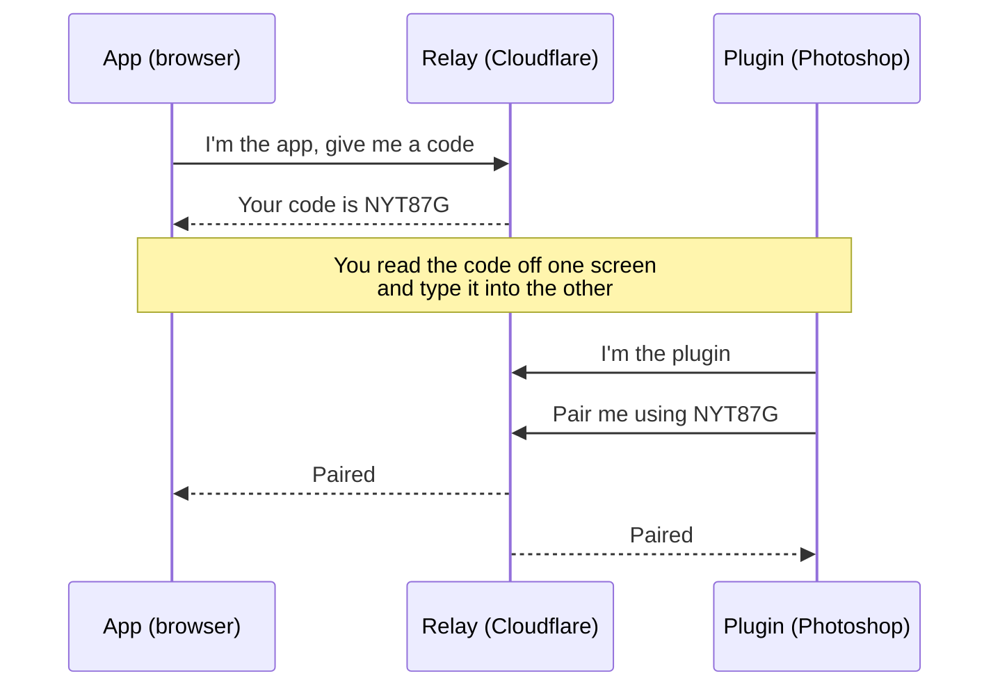
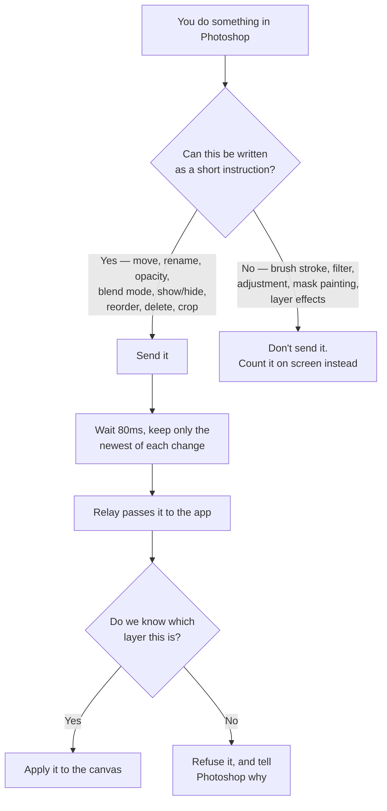
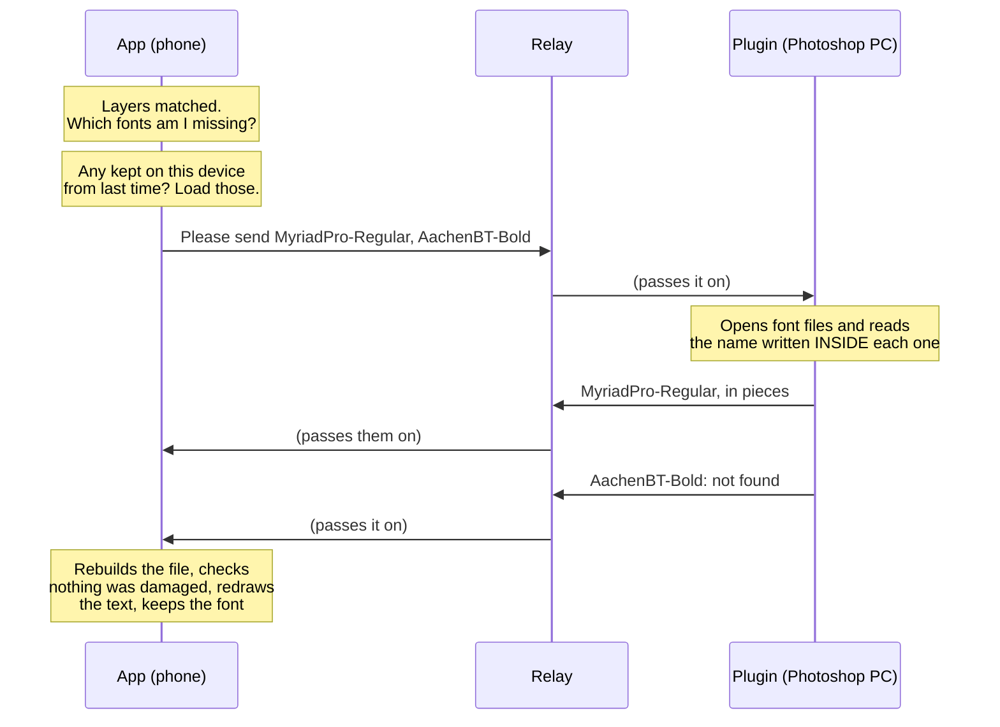

# How Photoshop sync works

A plain-language explainer. No code knowledge needed.

---

## What it does

You open a PSD file in Photoshop. You open **the same file** in the PSD Editor
app on your phone or browser. You link the two with a short code.

From then on, when you move a layer in Photoshop, it moves in the app too.

---

## The one idea behind all of it

**It sends the changes, not the file.**

The file never travels. Nothing is uploaded. Both sides already have the same
PSD open, so all that needs to cross the internet is a short message like:

> *"layer 7 moved to x=40, y=12"*

That is a few hundred bytes, instead of a 150 MB file.

This choice removes most of the hard problems — no upload, no waiting, no
storage, no "whose version wins". It creates exactly one new problem, and
solving that problem is most of what this system does. More on that below.

---

## The three pieces

```
   ┌──────────────────┐         ┌──────────────────┐        ┌──────────────────┐
   │   THE APP        │         │   THE RELAY      │        │   THE PLUGIN     │
   │                  │         │                  │        │                  │
   │  Your browser    │◀───────▶│  A small server  │◀──────▶│  A panel inside  │
   │  or phone        │         │  on Cloudflare   │        │  Photoshop       │
   │                  │         │                  │        │                  │
   │  Shows the file  │         │  Passes messages │        │  Watches what    │
   │  and applies     │         │  between the two │        │  you do and      │
   │  the changes     │         │  Stores nothing  │        │  reports it      │
   └──────────────────┘         └──────────────────┘        └──────────────────┘
```

The relay in the middle exists for one reason: your browser and Photoshop
cannot talk to each other directly. It is a post box. It reads nothing, keeps
nothing, and forgets everything when you disconnect.

---

## Step 1 — Linking the two



**About the code:**

| | |
|---|---|
| Length | 6 characters |
| Letters used | 32 — with `0`/`O` and `1`/`I` removed, because you have to read it off one screen and type it into another |
| Possible codes | About 1.07 billion |
| Lifetime | 5 minutes |
| Uses | Once. Then it's dead |

The code is the *only* thing protecting your session, so guessing it is
throttled two ways: **10 tries a minute** from any one place, and **10,000
failed tries a minute** across everyone combined. The second limit exists
because the first one alone doesn't help if someone attacks from a thousand
computers at once.

---

## Step 2 — Agreeing which layer is which

This is the hard part, and it is worth understanding, because everything else
depends on it.

When Photoshop says *"layer 7 moved"*, the app has to know **which of its own
layers layer 7 is**. And the two sides count layers completely differently:

```
   PHOTOSHOP sees                      THE APP sees
   ─────────────                       ────────────
   1. Backgrounds  (a group)           1. Sky
   2.   Sky                            2. Logo
   3.   (empty layer)                  3. Headline
   4. Logo
   5. Headline

   Groups count as layers.             Groups don't exist here.
                                       Empty layers were dropped.
```

Count down the list and you get the wrong answer. Photoshop's "layer 4" is
Logo; the app's fourth layer doesn't even exist.

**And getting this wrong is not a harmless error.** Nothing crashes. The
change simply gets applied to *the wrong layer* — which looks, to you, like the
app quietly damaging your artwork.

So the plugin sends its **whole layer list** once, at the start, and the app
matches them up by what they actually are — the layer's name, its kind, its
size and position, and which group it sits in. Never by counting.

It tries three ways, in order:

1. **Everything matches** — same name, group, kind, size.
2. **You renamed it on one side** — same group, kind, size, different name.
3. **You moved it between groups** — same name, kind, size, different group.

**If it still isn't sure, it refuses to guess and tells you.** Two layers with
the same name and the same size in the same group match nothing at all, and
both are listed on screen. A coin flip there would corrupt your file.

Groups and adjustment layers are listed too, because the app has nothing that
corresponds to them — so changes to those will never arrive, and you're told
that up front rather than left wondering.

This matching happens **once**, when you connect, and is remembered for the
whole session.

---

## Step 3 — What happens when you edit



**Why the 80ms wait?** Dragging a layer once makes Photoshop fire dozens of
"it moved" messages — one per tiny movement. Only the last one matters; the
rest are already out of date. So they're collected for 80ms and only the newest
of each is sent. You don't notice the delay, and it saves sending ninety-nine
messages that were obsolete before they arrived.

**Changes only travel one way: Photoshop → app.** Photoshop is the source of
truth. That's what removes any possibility of the two sides disagreeing.

---

## What doesn't sync — and why you're told

Five kinds of change **cannot** be sent, because they aren't instructions —
they're pixels, and pixels don't cross this connection:

| Change | Why not |
|---|---|
| Brush strokes | It's paint. There's no instruction that describes it |
| Filters (blur, sharpen…) | Same — the result is new pixels |
| Adjustment layers | The app's colour tools aren't Photoshop's; pretending otherwise would show you the wrong colours |
| Mask painting | Paint again |
| Layer effects (shadows, glows…) | Not implemented in the app's renderer |

**These are counted on screen in both panels, not hidden.** A sync that quietly
threw away half your work would be worse than one that admits it didn't send it.
If you need those changes in the app, re-open the file there.

---

## Fonts — sending the real typeface

A PSD stores font **names** (`MyriadPro-Regular`), never the fonts themselves.
So until the app has the font file, it draws your text in the closest font it
can guarantee — and says so.

Your fonts are sitting on the Photoshop computer, and the app is on another
device. So sync can fetch them for you.

**What you do, once:** in the Photoshop panel, click **Choose fonts folder…**
and pick `C:\Windows\Fonts` (and your own fonts folder, if you install fonts
just for yourself). The panel remembers it.

**What happens after that, every time you pair:**



**Only missing fonts travel.** A font the app already has is never sent again,
and fonts are kept on the device (up to 150 MB) so the next session doesn't need
them at all. The Fonts sheet has a **Remove synced fonts** button.

**How it finds the right file:** the file's *name* can't be trusted —
`HelvNeue_Rm.otf` doesn't say Helvetica Neue. Every font file has its real name
written inside it, the same name the PSD uses. The plugin reads that. It opens
the likely-looking files first, stops as soon as it finds what was asked for,
and remembers what it learned so it doesn't read the same files twice.

**What can't be sent — and you're told which, per font:**

| Font | Why not |
|---|---|
| Adobe Fonts (activated in Creative Cloud) | Adobe hides and encrypts these, and the licence doesn't allow copying them to another device. Install it there, or load the file by hand |
| Inside a `.ttc` collection file | The browser can't load a collection yet. Windows ships some system fonts this way |
| Over 32 MB | More than sync sends in one go |

**Nothing is stored in the middle.** Font files pass through the relay the same
way changes do — straight through, never kept. The only copy that stays is the
one on your own device, and you can remove it.

---

## What you'll see if something's wrong

| On screen | What it means | What to do |
|---|---|---|
| *"Type this code into the Photoshop panel"* | Waiting for you | Type the code |
| *"Live — 8 of 12 layers matched"* | Working. 4 layers had no counterpart | Open the list — it says why each one |
| *"Photoshop has other.psd at 4000×3000; this is 1200×800"* | **You have different files open** | Open the same file on both sides |
| *"Not syncing: Brush, filter… — 14 changes"* | Working normally. Those changes can't travel | Expected. Re-open the file to see them |
| *"Could not reach the relay"* | The address is wrong or the relay is down | Check the relay address in the panel |
| *"too many pairing attempts"* | Too many wrong codes | Wait a minute and get a fresh code |

Note the third row. Nothing can *force* both sides to open the same file — no
file ever crosses, so the sizes are the only clue there is. Without that
message, "0 of 12 matched" would look like broken software instead of the wrong
file being open.

---

## Where it runs

```
  https://psd-editor.pages.dev                 https://psd-sync-relay
       (the app, on Cloudflare Pages)            .jaswantdangi00.workers.dev
                    │                                     │
                    └──────────── secure link ────────────┘
                                        │
                              Photoshop plugin panel
```

The relay only accepts connections from the app's exact address. Anything else
is turned away before a connection is even opened. It stores no files, keeps no
history, and holds none of your data.

---

## Current status — read this before relying on it

| Piece | State |
|---|---|
| The relay | **Live and tested.** Linking, message passing, rejections, disconnects and font files all verified against the deployed server |
| The app side | **Built and tested** |
| The Photoshop plugin | **Loads and connects in real Photoshop.** Its logic runs in a simulated Photoshop in the tests |
| Edits syncing end to end | **Not yet confirmed in real Photoshop** |
| Fonts syncing end to end | **Built and tested, not yet run in real Photoshop** |

What's left is a real editing session. The most likely thing to be wrong is
how the plugin reads *which layer* a change belongs to, and how Photoshop
reports the folder you choose for fonts — and at every such point it is built
to send **nothing** rather than a guess when it isn't sure.

So if something is wrong there, the symptom will be **changes not arriving** —
not your artwork being damaged. That was a deliberate choice at every uncertain
point in the design.

`plugin/README.md` lists what to check, in order of how likely it is to bite.
